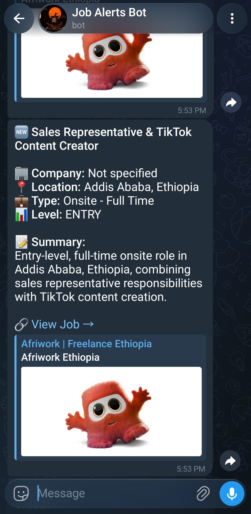
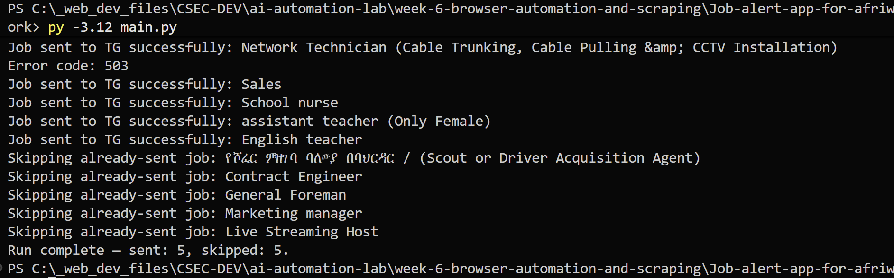
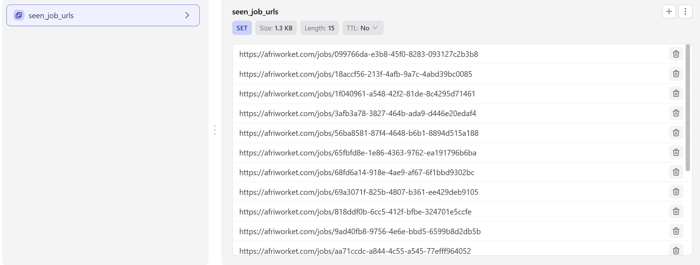
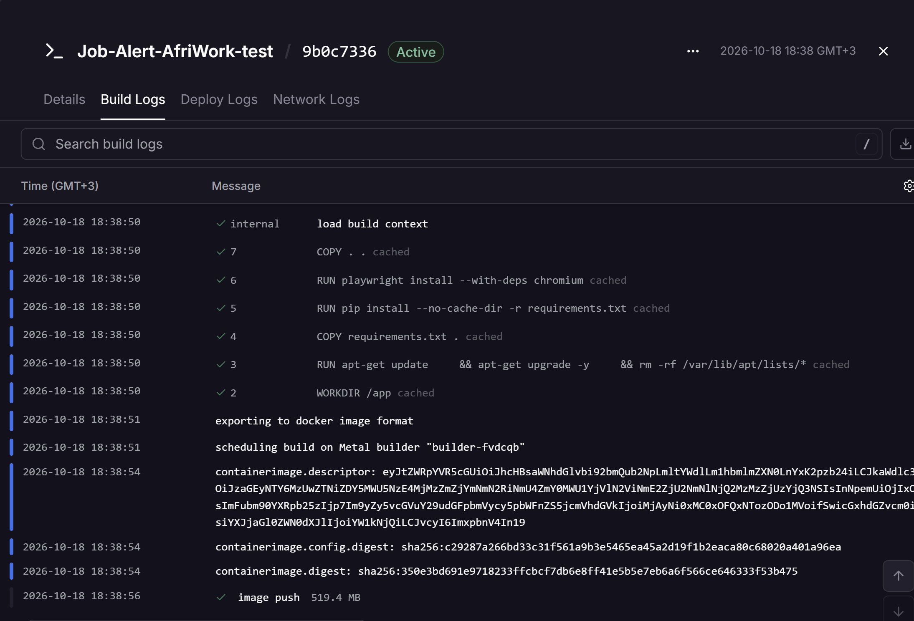

# Afriwork AI Job Alert Bot

An automated browser scraping and AI summarization pipeline that monitors [Afriwork](https://afriworket.com/jobs) for new job openings, extracts job details using Playwright, distills descriptions into structured summaries with Google Gemini, and delivers formatted notifications to Telegram with zero-duplicate guarantees.

---

## Architecture & Workflow

```text
┌────────────────────────────────┐
│   Afriwork Portal (/jobs)      │
└───────────────┬────────────────┘
                │
         1. Playwright
        Scrapes job URLs
                │
                ▼
┌────────────────────────────────┐
│    Upstash Redis Check         │◄─────── Deduplication Layer
│   (SMEMBERS seen_job_urls)     │         (Skips already sent jobs)
└───────────────┬────────────────┘
                │ If new URL
                ▼
┌────────────────────────────────┐
│ Playwright Detail Extraction   │◄─────── 1.5s Politeness Delay
│  (Type, Experience, Desc)      │
└───────────────┬────────────────┘
                │
                ▼
┌────────────────────────────────┐
│   Google Gemini 3.8 Flash      │◄─────── Structured Outputs via Pydantic
│ (Structured JSON Summarizer)   │         (Retry logic on 429/5xx)
└───────────────┬────────────────┘
                │
                ▼
┌────────────────────────────────┐
│  Telegram Bot Delivery (HTML)  │────────► Marks URL as seen in Redis
│   + Failure Alert Fallback     │          (SADD seen_job_urls)
└────────────────────────────────┘
```

1. **Browser Navigation & Discovery**: Launches headless Chromium via Playwright, navigates to `https://afriworket.com/jobs`, waits for dynamic content to hydrate, and collects listing URLs.
2. **Deduplication Check**: Queries an Upstash Redis database using its serverless REST API to compare collected URLs against already-processed jobs (`seen_job_urls` set). Already delivered jobs are skipped immediately.
3. **Polite Job Detail Scraping**: For each new job, Playwright visits the dedicated detail page with a 1.5-second rate-limiting delay, extracting title, company, job type, location, experience requirements, and full descriptions.
4. **Structured AI Summarization**: The job payload is serialized into JSON and sent to Google Gemini (`gemini-3.8-flash`) with strict Pydantic schema validation (`JobSummary`). Transient errors (rate limits or server hiccups) are automatically retried with exponential backoff.
5. **Formatted Telegram Notification**: Validated job summaries are sanitized for HTML entities and dispatched to the target Telegram chat with direct job links.
6. **Persistence & Failure Alerting**: Once successfully sent, the URL is committed to Redis. If any critical exception crashes the pipeline, a failure alert is sent directly to Telegram.

---

## Screenshots & Verification

### 1. Telegram Job Alert Notification

*Figure 1: Rich HTML job alert sent to Telegram featuring job metadata, AI summary, and direct link.*

### 2. Local Terminal Run (Discovery & Deduplication)

*Figure 2: Execution output demonstrating discovery, scraping, Telegram delivery, and subsequent skipping of duplicate jobs.*

### 3. Upstash Redis Deduplication Store

*Figure 3: Upstash Redis set (`seen_job_urls`) persisting processed job URLs across cron executions.*

### 4. Railway Cron Deployment & Container Logs

*Figure 4: Railway container execution output scheduled to run automatically on a daily cron trigger.*

---

## Tech Stack & Tools

- **Automation & Scraping**: [Playwright Python](https://playwright.dev/python/) (Headless Chromium)
- **AI & LLM**: [Google GenAI SDK](https://ai.google.dev/) (`gemini-3.8-flash`)
- **Schema Validation**: [Pydantic v2](https://docs.pydantic.dev/)
- **Deduplication Store**: [Upstash Redis](https://upstash.com/) (Serverless REST API via `requests`)
- **Alerting & Messaging**: [Telegram Bot API](https://core.telegram.org/bots/api)
- **Containerization**: [Docker](https://www.docker.com/) (Python 3.12 Slim on Debian Bookworm)
- **Scheduled Deployment**: [Railway](https://railway.app/) (Scheduled Cron Service: `0 5 * * *`)

---

## Project Structure

```text
Job-alert-app-for-afriwork/
├── AI_summarizer.py        # Gemini client configuration, system prompts, and retry logic
├── config.py               # Environment variable loading and validation
├── Dockerfile              # Container definition with system deps & Playwright Chromium
├── job_data_model.py       # Pydantic schema defining structured job summary output
├── main.py                 # Core orchestration script managing browser lifecycle & workflow
├── requirements.txt        # Pinned project dependencies
├── scraper.py              # Playwright selectors, pagination/link scraping, and rate limiting
├── seen_jobs.py            # Upstash Redis REST interface for job deduplication
└── send_to_telegram.py     # Telegram HTML notification formatter and crash alert handler
```

---

## Environment Variables

Create a `.env` file in this directory with the following keys:

```env
# Gemini API Key (from Google AI Studio)
GEMINI_API_KEY=your_gemini_api_key_here

# Telegram Bot Credentials
TELEGRAM_API_KEY=your_telegram_bot_token_here
CHAT_ID=your_telegram_chat_id_here

# Upstash Redis (Free Tier for Deduplication)
UPSTASH_REDIS_REST_URL=https://your-database.upstash.io
UPSTASH_REDIS_REST_TOKEN=your_upstash_rest_token_here
```

| Variable | Required | Description |
|---|---|---|
| `GEMINI_API_KEY` | **Yes** | Authenticates requests to Google's GenAI model. |
| `TELEGRAM_API_KEY` | **Yes** | Authentication token for your Telegram Bot from @BotFather. |
| `CHAT_ID` | **Yes** | Numeric user ID or group channel ID where alerts are delivered. |
| `UPSTASH_REDIS_REST_URL` | Optional | Upstash REST endpoint. If omitted, deduplication is disabled. |
| `UPSTASH_REDIS_REST_TOKEN` | Optional | Upstash bearer token for REST authorization. |

---

## Local Setup & Installation

### 1. Clone & Navigate
```bash
cd week-6-browser-automation-and-scraping/Job-alert-app-for-afriwork
```

### 2. Create Virtual Environment
```bash
python -m venv venv

# Windows (PowerShell):
.\venv\Scripts\Activate.ps1

# Linux / macOS:
source venv/bin/activate
```

### 3. Install Dependencies
```bash
pip install -r requirements.txt
```

### 4. Install Playwright Browsers
Install Chromium along with necessary system dependencies:
```bash
playwright install chromium
```

### 5. Run the Application
```bash
python main.py
```

On first execution, all newly scraped jobs are analyzed and sent to Telegram. On subsequent runs, seen URLs will be skipped automatically:
```text
Found 10 jobs!
Skipping already-sent job: Software Engineer
Skipping already-sent job: Marketing Specialist
Run complete — sent: 0, skipped: 10.
```

---

## Docker Containerization

The project includes an optimized `Dockerfile` based on Debian Bookworm slim:

```dockerfile
FROM python:3.12-slim-bookworm
WORKDIR /app

RUN apt-get update \
    && apt-get upgrade -y \
    && rm -rf /var/lib/apt/lists/*

COPY requirements.txt .

RUN pip install --no-cache-dir -r requirements.txt

RUN playwright install --with-deps chromium

COPY . .

CMD ["python","main.py"]
```

### Why these Dockerfile steps matter:
- **`python:3.12-slim-bookworm`**: A minimal Linux environment that drastically reduces image size compared to full Debian while remaining compatible with Playwright's shared libraries.
- **Layer Caching**: `requirements.txt` is copied and installed prior to copying project source code, ensuring dependency builds are cached when code edits occur.
- **`playwright install --with-deps chromium`**: Installs both the headless browser binary and necessary shared C libraries (X11, NSS, ALSA, etc.) needed to execute headless Chromium on Linux.

### Build and Run with Docker Locally:
```bash
# Build the container image
docker build -t afriwork-job-alert .

# Run the container with your .env file
docker run --rm --env-file .env afriwork-job-alert
```

---

## Cloud Deployment (Railway Cron)

The bot is designed to run as an ephemeral cron service on [Railway](https://railway.app/).

1. **Deploy Repository**: Connect the repository to Railway or deploy directly via Railway CLI:
   ```bash
   railway up
   ```
2. **Configure Environment Variables**: Under the Railway service **Variables** tab, input `GEMINI_API_KEY`, `TELEGRAM_API_KEY`, `CHAT_ID`, `UPSTASH_REDIS_REST_URL`, and `UPSTASH_REDIS_REST_TOKEN`.
3. **Set Cron Schedule**: In Railway **Settings** > **Cron Schedule**, configure:
   ```text
   0 5 * * *
   ```
   *(Fires daily at 05:00 UTC / 08:00 EAT).*
4. **Lifecycle**: Railway provisions the container, executes `python main.py`, scrapes new jobs, commits state to Upstash Redis, and exits cleanly without incurring idle billing.

---

## Production Reliability & Audit Improvements

Following a production readiness review, key resilience patterns were incorporated:

1. **Persistent Deduplication**: Replaced stateless memory sets with Upstash Redis REST calls. Since serverless cron containers spin down after each run, external persistence prevents re-sending the same jobs every morning.
2. **Resource Leak Prevention**: Wrapped Playwright browser lifecycle inside `try ... finally` blocks to ensure `browser.close()` terminates Chromium processes cleanly, preventing OOM failures in resource-constrained containers.
3. **Politeness & Anti-Bot Delays**: Added a 1.5-second pacing delay between job detail page navigations to avoid aggressive request bursts and IP bans.
4. **HTML Entity Escaping**: Utilized Python's `html.escape` across all user/job text fields before sending Telegram messages, preventing broken HTML tags or parse crashes on characters like `<`, `>`, and `&`.
5. **Automated Crash Alerts**: Integrated an outer exception handler that forwards unhandled runtime errors straight to Telegram, alerting maintainers immediately if the job board layout changes.
